# Cadrius: arquitetura e diagramas

Diagramas do sistema completo: contexto, infraestrutura, serviços, fluxos principais, segurança, rotinas, entrega e banco de dados.

- **Como ver:** o GitHub desenha os blocos Mermaid desta página. Cada diagrama também está em `img/` (SVG, para slides e documentos) e a fonte em `fontes/` (`.mmd`).
- **Atualizar:** edite o `.mmd` e gere de novo com `npx -p @mermaid-js/mermaid-cli mmdc -i fontes/X.mmd -o img/X.svg -b white`.
- **Banco de dados:** gerado dos modelos Django (115 tabelas, sem as internas do Django). Cada tabela mostra a chave, os campos principais (até 9) e as chaves estrangeiras; `cifrado` = campo cifrado com índice cego. As ligações com `Organization` e `CustomUser` só aparecem no núcleo, para não poluir.

## Índice

**Sistema e serviços**

- [Visão geral: quem usa e com o que o Cadrius conversa](#01-contexto)
- [Infraestrutura e contêineres (produção e teste)](#02-infraestrutura)
- [Módulos do back-end (apps Django) e dependências](#03-modulos)
- [Front-end: áreas e telas](#04-frontend)
- [Fluxo: login (senha, MFA e SSO) e sessão](#05-login)
- [Fluxo: leitura de documento com IA](#06-documento)
- [Fluxo: automação (gatilho → regra → aprovação → envio)](#07-automacao)
- [Fluxo: Assistente IA (ferramentas e confirmação)](#08-assistente)
- [Fluxo: assinatura, créditos e cobrança (Stripe)](#09-cobranca)
- [Fluxo: publicações do DJEN e prazos](#10-publicacoes)
- [Fluxo: importar carteira de clientes por pastas (Drive ou .zip)](#11-pastas)
- [Camadas de segurança e LGPD](#12-seguranca)
- [Rotinas agendadas (worker)](#13-rotinas)
- [Entrega contínua (CI/CD)](#14-deploy)

**Banco de dados**

- [Núcleo: contas, escritórios e acesso](#20-banco-01-nucleo)
- [Planos, créditos, pagamentos e fiscal da Cadrius](#20-banco-02-assinatura)
- [Clientes, processos, prazos e documentos](#20-banco-03-clientes)
- [Carteira (CRM) e financeiro do escritório](#20-banco-04-financeiro)
- [Automações, fluxos e e-mails](#20-banco-05-automacao)
- [IA: assistente, governança e aprendizado](#20-banco-06-ia)
- [Integrações, Google, ERP, marketing e suporte](#20-banco-07-integracoes)
- [Segurança, auditoria e LGPD](#20-banco-08-seguranca)

# Sistema e serviços

<a id="01-contexto"></a>
## Visão geral: quem usa e com o que o Cadrius conversa

Contexto (C4 nível 1):
- **Quem usa:** o escritório (advogados e equipe), o cliente do escritório (portal, captação e pesquisa) e a equipe Cadrius (Gestão).
- **Serviços externos:** os de que o Cadrius depende.

Imagem: [`img/01-contexto.svg`](img/01-contexto.svg)

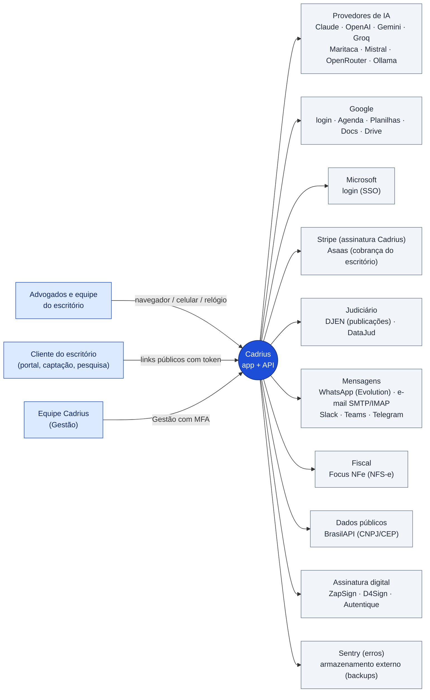

<a id="02-infraestrutura"></a>
## Infraestrutura e contêineres (produção e teste)

Os contêineres do servidor, como estão em `deploy/infra/docker-compose.yml` e `deploy/app/docker-compose.yml`:
- **Traefik:** compartilhado entre produção e teste.
- **Por ambiente** (`prod` e `staging`), cada um com o seu: web, worker, frontend, Redis e Evolution.
- **Postgres:** um servidor só, com uma base por ambiente.

Imagem: [`img/02-infraestrutura.svg`](img/02-infraestrutura.svg)

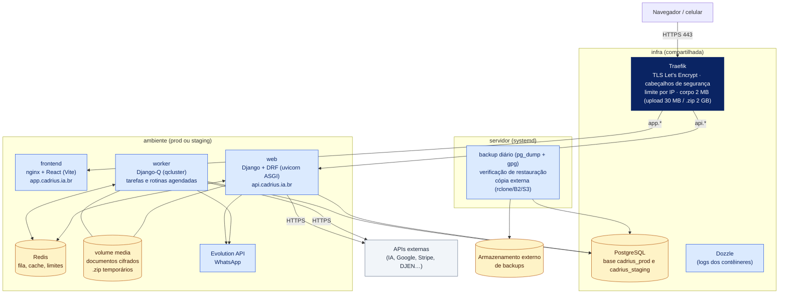

<a id="03-modulos"></a>
## Módulos do back-end (apps Django) e dependências

Os apps Django agrupados por área. As setas mostram quem chama quem nos fluxos principais.

Imagem: [`img/03-modulos.svg`](img/03-modulos.svg)

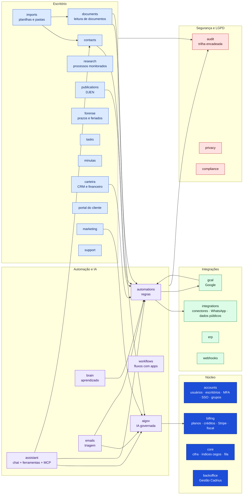

<a id="04-frontend"></a>
## Front-end: áreas e telas

A aplicação React (`Cadrius---Front-end`) e as áreas de navegação.

Imagem: [`img/04-frontend.svg`](img/04-frontend.svg)

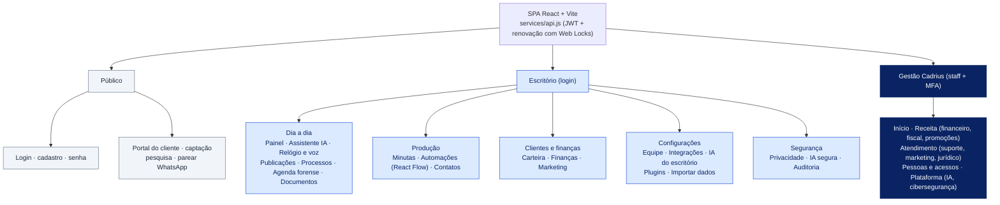

<a id="05-login"></a>
## Fluxo: login (senha, MFA e SSO) e sessão

JWT de acesso curto e refresh rotativo:
- **"Manter conectado":** 30 dias, renovados a cada uso.
- **Sem marcar:** 1 dia.
- **Gestão Cadrius:** exige MFA.

Imagem: [`img/05-login.svg`](img/05-login.svg)

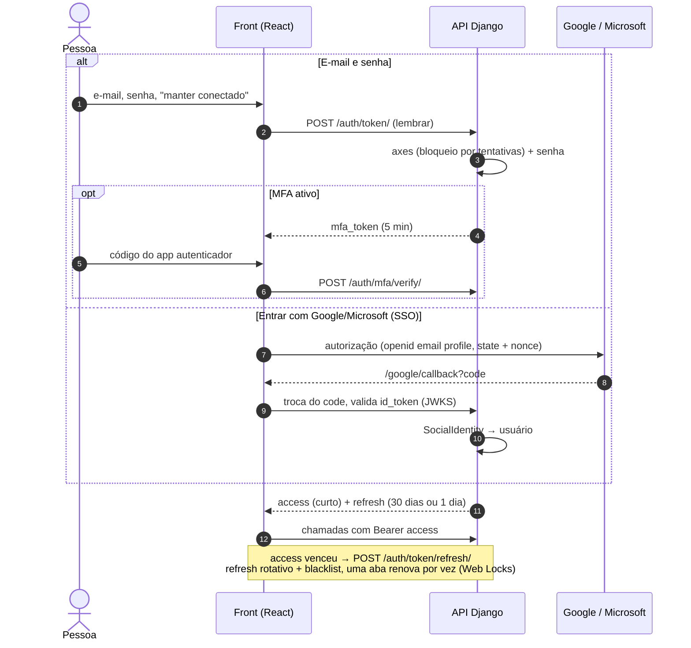

<a id="06-documento"></a>
## Fluxo: leitura de documento com IA

Pipeline de `documents/pipeline.py`:
- o arquivo é salvo cifrado;
- a leitura acontece no worker, com dados mascarados e IA governada;
- nada vira prazo sem a revisão de alguém.

Imagem: [`img/06-documento.svg`](img/06-documento.svg)

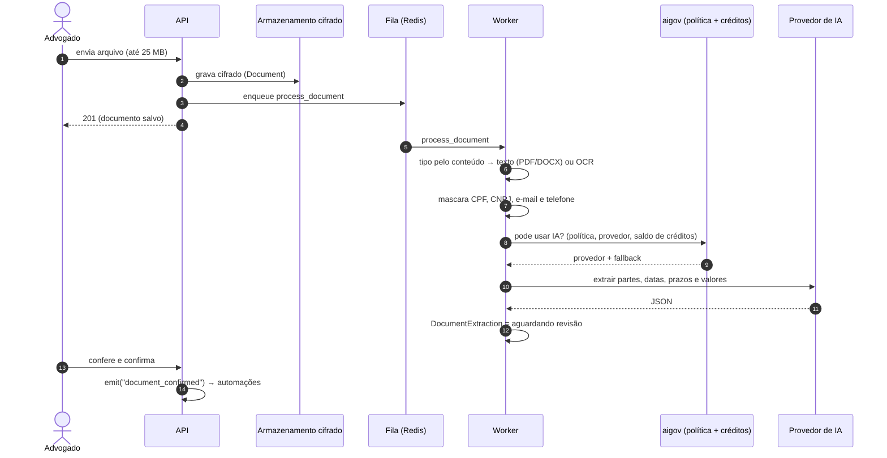

<a id="07-automacao"></a>
## Fluxo: automação (gatilho → regra → aprovação → envio)

O motor de `automations/engine.py`:
- **Ordem do motor:** deduplicação, condições, planejamento dos passos, execução dos internos, aprovação dos externos (conforme a autonomia) e checagem de consentimento na hora do envio.
- **Ao ligar a regra:** é obrigatório simular antes.

Imagem: [`img/07-automacao.svg`](img/07-automacao.svg)

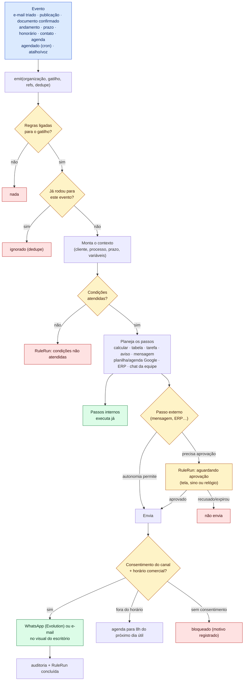

<a id="08-assistente"></a>
## Fluxo: Assistente IA (ferramentas e confirmação)

O Assistente consulta os dados por ferramentas. As ações (criar tarefa, regra, contato, mensagem, evento no Google…) viram um pedido de confirmação: só são executadas depois que a pessoa aprova.

Imagem: [`img/08-assistente.svg`](img/08-assistente.svg)

```mermaid
sequenceDiagram
    autonumber
    actor U as Advogado
    participant FE as Front
    participant API as assistant
    participant GOV as aigov
    participant LLM as IA (Claude, OpenAI…)
    participant T as Ferramentas
    U->>FE: "Crie uma automação: intimação por e-mail vira tarefa e avisa o João"
    FE->>API: POST /assistant/conversations/
    API->>GOV: política + créditos + provedor da atividade "assistente"
    API->>LLM: mensagens + catálogo de ferramentas (só as permitidas ao grupo de acesso)
    LLM-->>API: chama buscar_contatos / catalogo_de_automacao
    API->>T: executa (leitura, só dados do escritório)
    T-->>API: resultado (dados de terceiros marcados como não confiáveis)
    LLM-->>API: chama criar_regra(..., novo_contato)
    API->>API: PendingAction + resumo (prévia, nada gravado)
    API-->>FE: resposta + cartão "Aguardando sua confirmação"
    U->>FE: Confirmar
    FE->>API: POST /assistant/actions/{id}/decide/
    API->>T: cadastra o contato (se novo) + cria a regra desligada
    API->>API: auditoria
    API-->>FE: Feito + link para abrir o fluxo
```

<a id="09-cobranca"></a>
## Fluxo: assinatura, créditos e cobrança (Stripe)

Planos, pacotes de créditos e o adicional de mídia passam pelo Checkout do Stripe. A confirmação chega pelo webhook.

Imagem: [`img/09-cobranca.svg`](img/09-cobranca.svg)

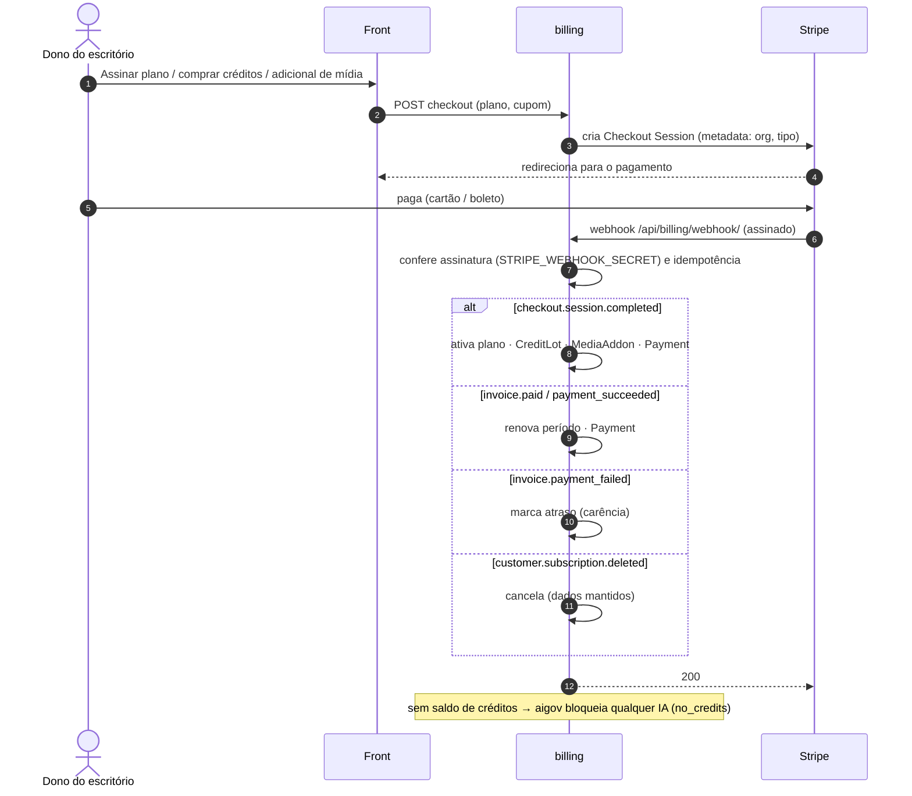

<a id="10-publicacoes"></a>
## Fluxo: publicações do DJEN e prazos

Rotina a cada 3 horas: busca as intimações das OABs acompanhadas, faz a triagem e sugere o prazo. O prazo só entra na agenda depois que alguém confirma.

Imagem: [`img/10-publicacoes.svg`](img/10-publicacoes.svg)

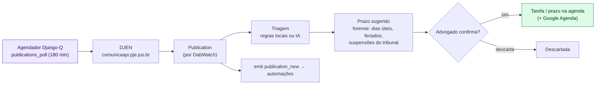

<a id="11-pastas"></a>
## Fluxo: importar carteira de clientes por pastas (Drive ou .zip)

CAD-234:
- cada pasta vira um cliente e os arquivos dentro dela, os documentos dele;
- a prévia não grava nada;
- a importação roda em etapas de 40 s e reimportar não duplica.

Imagem: [`img/11-pastas.svg`](img/11-pastas.svg)

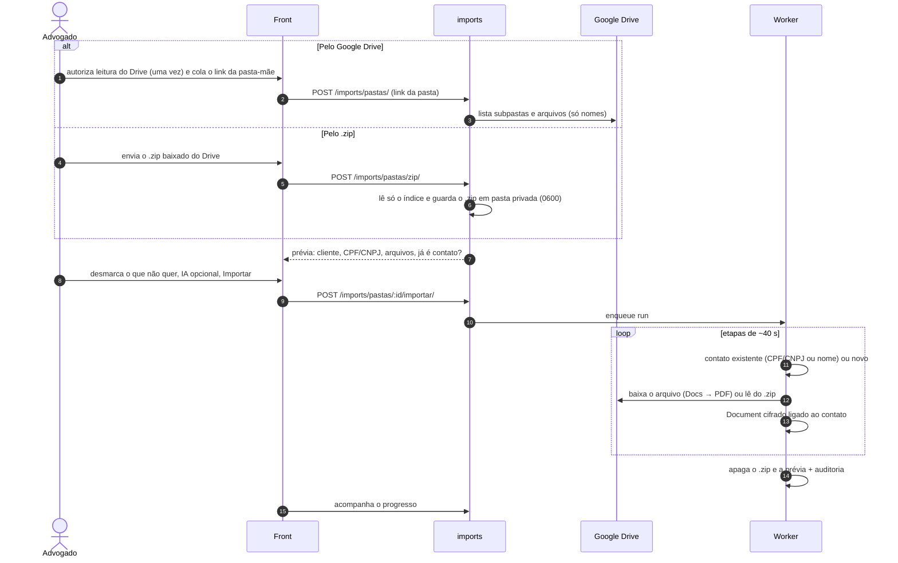

<a id="12-seguranca"></a>
## Camadas de segurança e LGPD

Defesa em profundidade, da borda aos dados.

Imagem: [`img/12-seguranca.svg`](img/12-seguranca.svg)

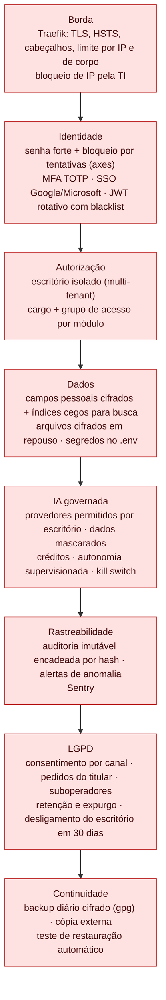

<a id="13-rotinas"></a>
## Rotinas agendadas (worker)

Agendadas pelo comando `setup_security_schedules` e executadas pelo Django-Q.

Imagem: [`img/13-rotinas.svg`](img/13-rotinas.svg)

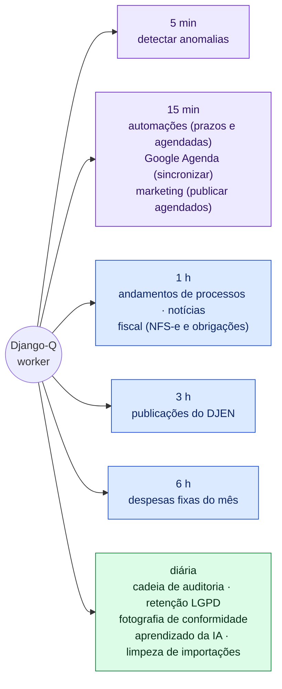

<a id="14-deploy"></a>
## Entrega contínua (CI/CD)

Do pull request ao servidor.

Imagem: [`img/14-deploy.svg`](img/14-deploy.svg)

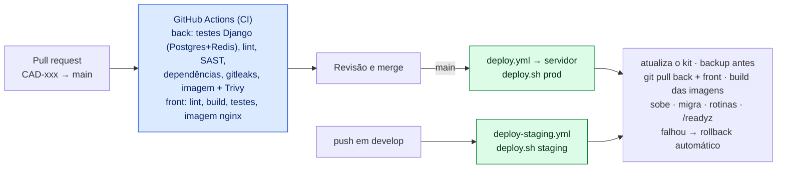

# Banco de dados

Toda tabela de dado de escritório tem `organization_id` (isolamento entre escritórios); quase todas têm `created_by`/`created_at`.

<a id="20-banco-01-nucleo"></a>
## Banco de dados: Núcleo: contas, escritórios e acesso

Tabelas: AccessGroup, CustomUser, MFADevice, MFARecoveryCode, Organization, OrganizationMembership, SocialIdentity, UserMessageSendCount. Gerado dos modelos Django. Mostra a chave, os principais campos ("cifrado" = guardado cifrado) e as ligações. Ligações com `Organization` e `CustomUser` ficam só no Núcleo, para não poluir o desenho.

Imagem: [`img/20-banco-01-nucleo.svg`](img/20-banco-01-nucleo.svg)

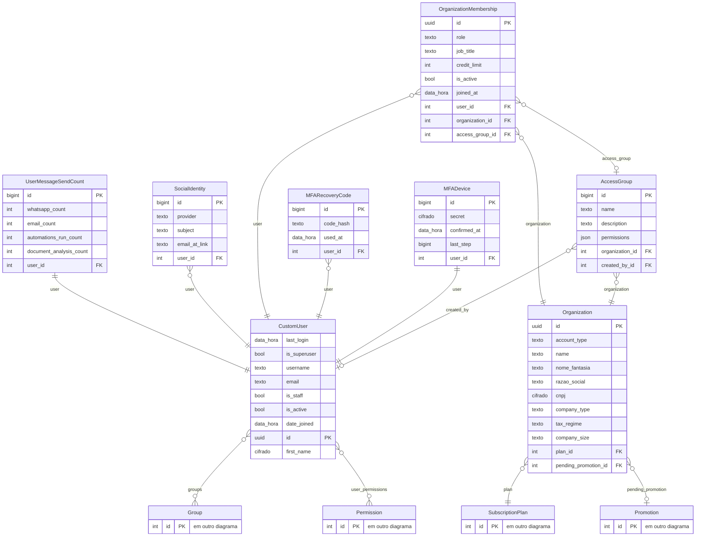

<a id="20-banco-02-assinatura"></a>
## Banco de dados: Planos, créditos, pagamentos e fiscal da Cadrius

Tabelas: AIUsageLog, BillingNotice, CreditLot, CreditPack, CreditWeight, FiscalObligation, FiscalObligationDone, MediaAddon, MemberCreditUsage, Payment, PlanPriceHistory, Promotion, PromotionRedemption, SubscriptionPlan. Gerado dos modelos Django. Mostra a chave, os principais campos ("cifrado" = guardado cifrado) e as ligações. Ligações com `Organization` e `CustomUser` ficam só no Núcleo, para não poluir o desenho.

Imagem: [`img/20-banco-02-assinatura.svg`](img/20-banco-02-assinatura.svg)

```mermaid
erDiagram
    AIUsageLog {
        bigint id PK
        data billing_cycle_month
        int extractions_count
        int organization_id FK
    }
    BillingNotice {
        bigint id PK
        texto title
        texto body
        texto severity
        json audience_tiers
        json audience_statuses
        data_hora starts_at
        data_hora ends_at
        bool is_active
    }
    CreditLot {
        bigint id PK
        int credits_total
        int credits_remaining
        data_hora expires_at
        texto stripe_session_id
        int amount_paid_cents
        int organization_id FK
    }
    CreditPack {
        bigint id PK
        texto name
        int credits
        decimal price_brl
        bool is_active
    }
    CreditWeight {
        bigint id PK
        texto operation
        texto label
        int credits
        bool is_active
    }
    FiscalObligation {
        bigint id PK
        texto code
        texto name
        texto description
        texto periodicity
        int due_day
        int due_month
        texto adjust
        bool active
    }
    FiscalObligationDone {
        bigint id PK
        texto competence
        data_hora done_at
        texto note
        int obligation_id FK
        int done_by_id FK
    }
    MediaAddon {
        bigint id PK
        bool active
        texto source
        texto stripe_subscription_id
        texto stripe_session_id
        data_hora started_at
        data_hora ends_at
        int organization_id FK
    }
    MemberCreditUsage {
        bigint id PK
        data billing_cycle_month
        int credits_used
        int membership_id FK
    }
    Payment {
        bigint id PK
        texto kind
        texto description
        int amount_cents
        data_hora paid_at
        texto stripe_id
        texto invoice_status
        texto invoice_number
        data invoice_issued_at
        int organization_id FK
    }
    PlanPriceHistory {
        bigint id PK
        decimal old_price
        decimal new_price
        int old_credits
        int new_credits
        texto changed_by
        data_hora changed_at
        int plan_id FK
    }
    Promotion {
        bigint id PK
        texto code
        texto name
        texto description
        texto kind
        decimal value
        texto duration
        int duration_months
        json plan_tiers
    }
    PromotionRedemption {
        bigint id PK
        texto stripe_session_id
        int promotion_id FK
        int organization_id FK
    }
    SubscriptionPlan {
        bigint id PK
        texto name
        texto tier
        decimal price_brl
        int max_users
        int max_ai_extractions
        bool is_active
    }
    OrganizationMembership {
        int id PK "em outro diagrama"
    }
    FiscalObligationDone }o--|| FiscalObligation : "obligation"
    MemberCreditUsage }o--|| OrganizationMembership : "membership"
    PlanPriceHistory }o--|| SubscriptionPlan : "plan"
    PromotionRedemption }o--|| Promotion : "promotion"
```

<a id="20-banco-03-clientes"></a>
## Banco de dados: Clientes, processos, prazos e documentos

Tabelas: CaseMovement, ClientDocument, Contact, CourtInfo, CourtSuspension, Document, DocumentExtraction, Draft, DraftTemplate, FolderImport, Holiday, ImportJob, IntegrationConfig, IntegrationLog, MonitoredCase, NewsItem, OabWatch, PortalLink, Publication, UserTask. Gerado dos modelos Django. Mostra a chave, os principais campos ("cifrado" = guardado cifrado) e as ligações. Ligações com `Organization` e `CustomUser` ficam só no Núcleo, para não poluir o desenho.

Imagem: [`img/20-banco-03-clientes.svg`](img/20-banco-03-clientes.svg)

```mermaid
erDiagram
    Contact {
        bigint id PK
        texto kind
        texto person_type
        cifrado name
        cifrado document
        cifrado email
        cifrado phone
        cifrado notes
        json tags
        int organization_id FK
        int created_by_id FK
    }
    ClientDocument {
        bigint id PK
        cifrado nome_cliente
        int documento_id FK
    }
    Document {
        bigint id PK
        texto nome
        texto tipo
        texto status
        data_hora data
        arquivo arquivo
        int organization_id FK
        int uploaded_by_id FK
        int contact_id FK
    }
    DocumentExtraction {
        bigint id PK
        texto status
        texto stage
        texto detected_kind
        int text_chars
        bool ocr_used
        texto provider
        int confidence
        cifrado fields
        int document_id FK
        int reviewed_by_id FK
    }
    CourtInfo {
        bigint id PK
        texto tribunal
        texto name
        texto balcao_virtual_url
        texto services_url
        texto hearings_url
        texto hours
        texto notes
        int updated_by_id FK
    }
    CourtSuspension {
        bigint id PK
        texto tribunal
        texto comarca
        texto kind
        data start
        data end
        texto reason
        texto source_url
        int created_by_id FK
    }
    Holiday {
        bigint id PK
        data date
        texto name
        texto tribunal
        bool yearly
        int organization_id FK
    }
    FolderImport {
        bigint id PK
        texto source
        texto label
        texto drive_folder_id
        texto archive_path
        cifrado plan
        json options
        json progress
        texto status
        int organization_id FK
        int created_by_id FK
    }
    ImportJob {
        bigint id PK
        texto target
        texto filename
        texto status
        json columns
        cifrado rows
        int rows_total
        json mapping
        json summary
        int organization_id FK
        int created_by_id FK
    }
    Draft {
        bigint id PK
        texto template_key
        texto title
        texto source_type
        int source_id
        cifrado content
        cifrado generated_content
        cifrado citations
        int pending
        int organization_id FK
        int created_by_id FK
        int reviewed_by_id FK
    }
    DraftTemplate {
        bigint id PK
        texto name
        texto kind
        texto body
        int organization_id FK
        int created_by_id FK
    }
    PortalLink {
        bigint id PK
        texto token_hash
        texto hint
        bool show_finance
        data_hora expires_at
        data_hora revoked_at
        data_hora last_access_at
        int access_count
        int organization_id FK
        int contact_id FK
        int created_by_id FK
    }
    OabWatch {
        bigint id PK
        texto numero
        texto uf
        texto nome
        bool is_active
        data_hora last_checked_at
        texto last_error
        int organization_id FK
        int responsavel_id FK
    }
    Publication {
        bigint id PK
        texto source
        texto external_id
        texto tribunal
        texto tipo
        texto orgao
        texto classe
        cifrado cnj
        cifrado texto
        int organization_id FK
        int watch_id FK
        int case_id FK
        int task_id FK
        int reviewed_by_id FK
    }
    CaseMovement {
        bigint id PK
        data_hora occurred_at
        texto code
        texto name
        texto complement
        texto digest
        bool notified
        int case_id FK
    }
    MonitoredCase {
        bigint id PK
        cifrado cnj
        texto tribunal
        cifrado label
        bool is_active
        data_hora last_checked_at
        data_hora last_movement_at
        texto last_error
        int organization_id FK
        int responsavel_id FK
        int client_id FK
    }
    NewsItem {
        bigint id PK
        texto source
        texto url
        texto title
        texto summary
        data_hora published_at
    }
    IntegrationConfig {
        bigint id PK
        texto name
        cifrado trello_api_key
        cifrado trello_api_token
        texto trello_list_id
        cifrado telegram_bot_token
        texto telegram_chat_id
        bool is_active
    }
    IntegrationLog {
        bigint id PK
        texto service
        texto status
        json request_data
        int response_code
        json response_body
        data_hora attempted_at
        int email_message_id FK
    }
    UserTask {
        bigint id PK
        texto titulo
        texto descricao
        data_hora scheduled_at
        texto priority
        bool sincronizar
        bool completed
        int responsavel_id FK
    }
    EmailMessage {
        int id PK "em outro diagrama"
    }
    ClientDocument }o--|| Document : "documento"
    Document }o--o| Contact : "contact"
    DocumentExtraction ||--|| Document : "document"
    PortalLink }o--|| Contact : "contact"
    Publication }o--o| OabWatch : "watch"
    Publication }o--o| MonitoredCase : "case"
    Publication }o--o| UserTask : "task"
    CaseMovement }o--|| MonitoredCase : "case"
    MonitoredCase }o--o| Contact : "client"
    IntegrationLog }o--|| EmailMessage : "email_message"
```

<a id="20-banco-04-financeiro"></a>
## Banco de dados: Carteira (CRM) e financeiro do escritório

Tabelas: AsaasEvent, Expense, FeeAgreement, FinanceSettings, Opportunity, Receivable, RecurringExpense. Gerado dos modelos Django. Mostra a chave, os principais campos ("cifrado" = guardado cifrado) e as ligações. Ligações com `Organization` e `CustomUser` ficam só no Núcleo, para não poluir o desenho.

Imagem: [`img/20-banco-04-financeiro.svg`](img/20-banco-04-financeiro.svg)

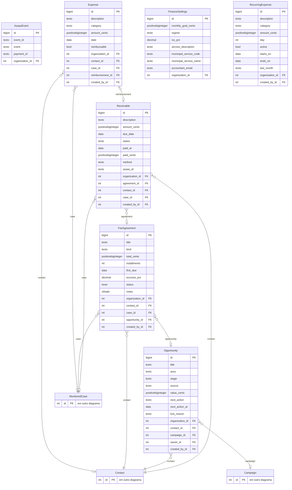

<a id="20-banco-05-automacao"></a>
## Banco de dados: Automações, fluxos e e-mails

Tabelas: Action, EmailMessage, EmailTriage, ExecutionLog, MailBox, Notification, PersonalDevice, Rule, RuleRun, Trigger, WebhookTrigger, Workflow. Gerado dos modelos Django. Mostra a chave, os principais campos ("cifrado" = guardado cifrado) e as ligações. Ligações com `Organization` e `CustomUser` ficam só no Núcleo, para não poluir o desenho.

Imagem: [`img/20-banco-05-automacao.svg`](img/20-banco-05-automacao.svg)

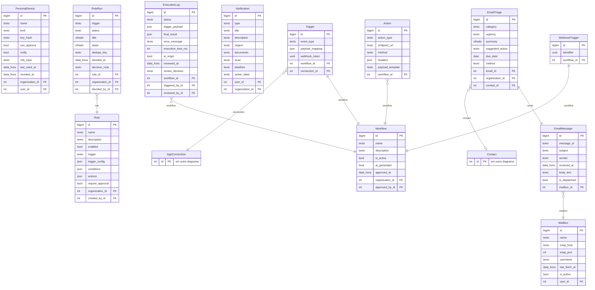

<a id="20-banco-06-ia"></a>
## Banco de dados: IA: assistente, governança e aprendizado

Tabelas: AIActionLog, AIFeedback, AIGovernancePolicy, AIRoute, AssistantSettings, AutomationSuggestion, AutonomyLevel, AutonomyProposal, Conversation, ExtractionProfile, GlobalAISwitch, MemoryItem, Message, OfficeProfile, OfficeRule, OrgAIKey, PendingAction, PersonalToken. Gerado dos modelos Django. Mostra a chave, os principais campos ("cifrado" = guardado cifrado) e as ligações. Ligações com `Organization` e `CustomUser` ficam só no Núcleo, para não poluir o desenho.

Imagem: [`img/20-banco-06-ia.svg`](img/20-banco-06-ia.svg)

```mermaid
erDiagram
    AIActionLog {
        bigint id PK
        uuid organization_id
        texto user_ref
        texto kind
        texto provider
        json data_categories
        int input_chars
        int duration_ms
        bool success
    }
    AIGovernancePolicy {
        bigint id PK
        bool ai_enabled
        texto autonomy_level
        json allowed_providers
        int daily_ai_request_limit
        int max_actions_per_ai_workflow
        texto updated_by
        int organization_id FK
    }
    AIRoute {
        bigint id PK
        texto activity
        json providers
        bool use_reserves
        texto updated_by
    }
    GlobalAISwitch {
        int id PK
        bool ai_enabled
        texto reason
        texto changed_by
        data_hora changed_at
    }
    AssistantSettings {
        bigint id PK
        bool case_strategy
        bool mcp_enabled
        bool use_memory
        int organization_id FK
    }
    Conversation {
        bigint id PK
        texto title
        texto mode
        int organization_id FK
        int user_id FK
        int case_id FK
        int contact_id FK
    }
    Message {
        bigint id PK
        texto role
        cifrado content
        texto provider
        json tools
        int conversation_id FK
    }
    OrgAIKey {
        bigint id PK
        texto provider
        cifrado api_key
        texto base_url
        texto model
        bool paid_account
        texto last4
        data_hora last_used_at
        int organization_id FK
        int created_by_id FK
    }
    PendingAction {
        bigint id PK
        texto tool
        cifrado arguments
        cifrado summary
        texto status
        cifrado result
        data_hora decided_at
        int conversation_id FK
        int message_id FK
    }
    PersonalToken {
        bigint id PK
        texto name
        texto prefix
        texto token_hash
        texto scope
        data_hora expires_at
        data_hora last_used_at
        int uses
        data_hora revoked_at
        int organization_id FK
        int user_id FK
    }
    AIFeedback {
        bigint id PK
        texto action_kind
        texto decision
        texto subject
        cifrado changes
        int confidence
        int organization_id FK
        int user_id FK
    }
    AutomationSuggestion {
        bigint id PK
        texto key
        texto title
        cifrado reason
        int evidence
        cifrado payload
        texto status
        data_hora decided_at
        int organization_id FK
        int rule_id FK
        int decided_by_id FK
    }
    AutonomyLevel {
        bigint id PK
        texto action_kind
        texto mode
        int organization_id FK
        int updated_by_id FK
    }
    AutonomyProposal {
        bigint id PK
        texto action_kind
        texto from_mode
        texto to_mode
        int samples
        decimal approval_rate
        texto status
        data_hora decided_at
        int organization_id FK
        int decided_by_id FK
    }
    MemoryItem {
        bigint id PK
        texto kind
        texto title
        cifrado text
        cifrado payload
        cifrado embedding
        texto source
        int organization_id FK
        int created_by_id FK
    }
    OfficeProfile {
        bigint id PK
        json areas
        texto audience
        texto city
        texto tone
        texto signature
        json social
        json auto_stats
        texto email_layout
        int organization_id FK
    }
    OfficeRule {
        bigint id PK
        texto kind
        texto field
        texto from_value
        texto to_value
        int evidence
        texto status
        data_hora decided_at
        int organization_id FK
        int decided_by_id FK
    }
    ExtractionProfile {
        bigint id PK
        texto name
        texto ai_provider
        texto system_prompt_template
        texto pydantic_schema_name
        int user_id FK
    }
    Contact {
        int id PK "em outro diagrama"
    }
    MonitoredCase {
        int id PK "em outro diagrama"
    }
    Rule {
        int id PK "em outro diagrama"
    }
    Conversation }o--o| MonitoredCase : "case"
    Conversation }o--o| Contact : "contact"
    Message }o--|| Conversation : "conversation"
    PendingAction }o--|| Conversation : "conversation"
    PendingAction }o--o| Message : "message"
    AutomationSuggestion }o--o| Rule : "rule"
```

<a id="20-banco-07-integracoes"></a>
## Banco de dados: Integrações, Google, ERP, marketing e suporte

Tabelas: AppConnection, Campaign, CaptureForm, ContentPiece, CustomizationRequest, ErpCallLog, ErpConnector, ExternalEvent, GoogleCalendarApp, GoogleCalendarLink, GoogleFile, IntegrationLog, MarketingAsset, SatisfactionSurvey, SupportAccessGrant, TaskEventMap, Ticket, TicketMessage. Gerado dos modelos Django. Mostra a chave, os principais campos ("cifrado" = guardado cifrado) e as ligações. Ligações com `Organization` e `CustomUser` ficam só no Núcleo, para não poluir o desenho.

Imagem: [`img/20-banco-07-integracoes.svg`](img/20-banco-07-integracoes.svg)

```mermaid
erDiagram
    ErpCallLog {
        bigint id PK
        texto operation
        bool dry_run
        bool ok
        int status_code
        texto error
        int connector_id FK
        int actor_id FK
    }
    ErpConnector {
        bigint id PK
        texto name
        texto preset
        texto base_url
        cifrado credentials
        json operations
        bool live_enabled
        bool is_active
        int organization_id FK
        int created_by_id FK
    }
    ExternalEvent {
        bigint id PK
        texto event_id
        cifrado title
        cifrado description
        cifrado location
        data_hora start
        data_hora end
        bool all_day
        texto kind
        int link_id FK
        int organization_id FK
        int case_id FK
        int contact_id FK
        int task_id FK
    }
    GoogleCalendarApp {
        bigint id PK
        texto client_id
        cifrado client_secret
        bool uses_platform
        bool enabled
        bool share_details
        int event_minutes
        int organization_id FK
    }
    GoogleCalendarLink {
        bigint id PK
        cifrado refresh_token
        texto calendar_id
        texto status
        texto sync_token
        data_hora last_sync_at
        texto last_error
        data_hora connected_at
        bool import_events
        int user_id FK
        int app_id FK
    }
    GoogleFile {
        bigint id PK
        texto kind
        texto name
        texto file_id
        texto url
        data_hora used_at
        int link_id FK
    }
    TaskEventMap {
        bigint id PK
        texto event_id
        data_hora last_synced_at
        int task_id FK
        int link_id FK
    }
    AppConnection {
        bigint id PK
        texto name
        texto app_name
        cifrado credentials
        bool is_active
        int user_id FK
    }
    IntegrationLog {
        bigint id PK
        texto status
        json request_data
        int response_code
        json response_body
        texto error_message
        data_hora attempted_at
        int connection_id FK
    }
    Campaign {
        bigint id PK
        texto scope
        texto name
        texto goal
        texto audience
        json channels
        data starts_on
        data ends_on
        texto notes
        int organization_id FK
        int created_by_id FK
    }
    CaptureForm {
        bigint id PK
        texto token
        texto title
        texto intro
        json areas
        texto thank_you
        bool active
        json compliance
        int submissions
        int organization_id FK
        int campaign_id FK
        int created_by_id FK
    }
    ContentPiece {
        bigint id PK
        texto scope
        texto channel
        texto theme
        texto title
        texto body
        json hashtags
        texto image_hint
        texto image_url
        int organization_id FK
        int campaign_id FK
        int created_by_id FK
        int approved_by_id FK
    }
    MarketingAsset {
        bigint id PK
        texto scope
        texto name
        texto file
        int width
        int height
        int organization_id FK
        int created_by_id FK
    }
    SatisfactionSurvey {
        bigint id PK
        texto token
        texto reason
        int score
        cifrado comment
        data_hora expires_at
        data_hora answered_at
        int organization_id FK
        int contact_id FK
    }
    CustomizationRequest {
        bigint id PK
        texto area
        cifrado objective
        cifrado example
        texto frequency
        int users_affected
        data wanted_by
        texto stage
        cifrado proposal
        int ticket_id FK
        int approved_by_id FK
    }
    SupportAccessGrant {
        bigint id PK
        data_hora expires_at
        data_hora revoked_at
        int ticket_id FK
        int granted_by_id FK
    }
    Ticket {
        bigint id PK
        cifrado subject
        texto category
        texto priority
        texto status
        texto page_url
        data_hora first_response_at
        data_hora resolved_at
        int organization_id FK
        int opened_by_id FK
        int assigned_to_id FK
    }
    TicketMessage {
        bigint id PK
        bool from_staff
        bool internal
        cifrado body
        int ticket_id FK
        int author_id FK
    }
    Contact {
        int id PK "em outro diagrama"
    }
    MonitoredCase {
        int id PK "em outro diagrama"
    }
    UserTask {
        int id PK "em outro diagrama"
    }
    ErpCallLog }o--|| ErpConnector : "connector"
    ExternalEvent }o--|| GoogleCalendarLink : "link"
    ExternalEvent }o--o| MonitoredCase : "case"
    ExternalEvent }o--o| Contact : "contact"
    ExternalEvent }o--o| UserTask : "task"
    GoogleCalendarLink }o--|| GoogleCalendarApp : "app"
    GoogleFile }o--|| GoogleCalendarLink : "link"
    TaskEventMap ||--|| UserTask : "task"
    TaskEventMap }o--|| GoogleCalendarLink : "link"
    IntegrationLog }o--o| AppConnection : "connection"
    CaptureForm }o--o| Campaign : "campaign"
    ContentPiece }o--o| Campaign : "campaign"
    SatisfactionSurvey }o--|| Contact : "contact"
    CustomizationRequest ||--|| Ticket : "ticket"
    SupportAccessGrant }o--|| Ticket : "ticket"
    TicketMessage }o--|| Ticket : "ticket"
```

<a id="20-banco-08-seguranca"></a>
## Banco de dados: Segurança, auditoria e LGPD

Tabelas: AnomalyAlert, AuditChainHead, AuditCheckpoint, AuditEvent, BlockedIP, ComplianceSnapshot, ConsentRecord, ControlAssessment, DataSubjectRequest, LegalDocument, OrganizationOffboarding, SubprocessorEntry. Gerado dos modelos Django. Mostra a chave, os principais campos ("cifrado" = guardado cifrado) e as ligações. Ligações com `Organization` e `CustomUser` ficam só no Núcleo, para não poluir o desenho.

Imagem: [`img/20-banco-08-seguranca.svg`](img/20-banco-08-seguranca.svg)

```mermaid
erDiagram
    AnomalyAlert {
        bigint id PK
        texto rule
        texto severity
        texto status
        texto actor_id
        texto actor_label
        uuid organization_id
        ip ip
        texto summary
    }
    AuditChainHead {
        int id PK
        bigint last_seq
        texto last_hash
    }
    AuditCheckpoint {
        bigint id PK
        bigint purged_until_seq
        texto last_hash
        int purged_count
        texto reason
    }
    AuditEvent {
        bigint seq PK
        uuid uid
        data_hora occurred_at
        texto request_id
        texto actor_type
        texto actor_id
        texto actor_label
        uuid organization_id
        texto action
    }
    BlockedIP {
        bigint id PK
        texto network
        texto reason
        texto created_by
        data_hora expires_at
        int hits
        data_hora last_hit_at
    }
    ComplianceSnapshot {
        bigint id PK
        texto framework
        real score
        json counts
        json failing
    }
    ControlAssessment {
        bigint id PK
        texto framework
        texto control_id
        texto status
        texto owner
        texto evidence_url
        texto justification
        texto reviewed_by
        data_hora reviewed_at
    }
    ConsentRecord {
        bigint id PK
        texto user_ref
        uuid organization_id
        texto purpose
        texto legal_basis
        bool granted
        data_hora occurred_at
        ip ip
        texto user_agent_hash
        int user_id FK
        int document_id FK
    }
    DataSubjectRequest {
        uuid id PK
        texto user_ref
        uuid organization_id
        texto type
        texto status
        texto notes
        data_hora opened_at
        data_hora due_at
        data_hora fulfilled_at
        int user_id FK
    }
    LegalDocument {
        bigint id PK
        texto kind
        texto version
        texto title
        texto content_md
        texto content_sha256
        texto locale
        bool requires_reconsent
        bool is_current
    }
    OrganizationOffboarding {
        bigint id PK
        uuid organization_id
        texto organization_name
        texto requested_by
        data_hora requested_at
        data_hora purge_after
        texto status
        data_hora purged_at
        json summary
    }
    SubprocessorEntry {
        bigint id PK
        texto name
        texto country
        texto purpose
        json data_categories
        bool international_transfer
        texto safeguards
        texto dpa_url
        bool contract_verified
    }
    ConsentRecord }o--|| LegalDocument : "document"
```
