# Cadrius: arquitetura e diagramas

> Gerado por `gerador/render.mjs` em 2026-11-22. Não edite à mão: mude `fontes/` ou `gerador/catalogo.json` e gere de novo.

- **Caderno em PDF:** [CADERNO_DE_ARQUITETURA.pdf](CADERNO_DE_ARQUITETURA.pdf) (40 pranchas, vetorial, para imprimir ou apresentar).
- **Padrão visual, pesquisa e regras:** [PADRAO_VISUAL.md](PADRAO_VISUAL.md).
- **Formatos:** cada prancha está em `pranchas/` (PNG 3200×1800, com título e legenda) e `svg/` (só o desenho, vetorial).

## Índice

**Arquitetura (modelo C4)**

- [A01 · Visão geral: quem usa o Cadrius e com o que ele conversa](#a01)
- [A02 · Do que o Cadrius é feito: aplicações e bancos de dados](#a02)
- [A03 · Dentro da API: núcleo e rotina do escritório](#a03)
- [A04 · Dentro da API: automação, IA e integrações](#a04)
- [A05 · Dentro da aplicação web: áreas e acesso à API](#a05)
- [A06 · Onde roda: servidor, contêineres e backups](#a06)
- [A07 · Do pull request à produção](#a07)

**Fluxos**

- [F01 · Login com senha e segundo fator (MFA)](#f01)
- [F02 · Login com Google ou Microsoft (SSO)](#f02)
- [F03 · Leitura de documento com IA](#f03)
- [F04 · Automação: do evento ao plano](#f04)
- [F05 · Automação: aprovação e envio](#f05)
- [F06 · Assistente IA: pedido, prévia e confirmação](#f06)
- [F07 · Assinatura e pagamento (Stripe)](#f07)
- [F08 · Publicações do DJEN e prazos](#f08)
- [F09 · Importação da carteira de clientes (pastas)](#f09)

**Segurança e operação**

- [S01 · As 8 camadas de proteção](#s01)
- [S02 · Ciclo de vida dos dados pessoais](#s02)
- [S03 · Rotinas automáticas do servidor](#s03)

**Banco de dados**

- [D00 · Banco de dados: mapa das áreas](#d00)
- [D01 · Banco de dados: Escritórios e vínculos](#d01)
- [D02 · Banco de dados: Login e segurança da conta](#d02)
- [D03 · Banco de dados: Assinatura, pagamentos e fiscal da Cadrius](#d03)
- [D04 · Banco de dados: Créditos e IA governada](#d04)
- [D05 · Banco de dados: Clientes e documentos](#d05)
- [D06 · Banco de dados: Processos, publicações e prazos](#d06)
- [D07 · Banco de dados: Tarefas, minutas e Google Agenda](#d07)
- [D08 · Banco de dados: Carteira e honorários](#d08)
- [D09 · Banco de dados: Financeiro do escritório](#d09)
- [D10 · Banco de dados: Marketing](#d10)
- [D11 · Banco de dados: Regras de automação](#d11)
- [D12 · Banco de dados: Fluxos com aplicativos](#d12)
- [D13 · Banco de dados: Conversas do Assistente](#d13)
- [D14 · Banco de dados: Configuração do Assistente](#d14)
- [D15 · Banco de dados: Aprendizado da IA](#d15)
- [D16 · Banco de dados: E-mails e avisos](#d16)
- [D17 · Banco de dados: Conectores e suporte](#d17)
- [D18 · Banco de dados: Auditoria e segurança](#d18)
- [D19 · Banco de dados: Privacidade (LGPD)](#d19)
- [D20 · Banco de dados: Filas e agendamentos (Django-Q)](#d20)

## Arquitetura (modelo C4)

### A01 · Visão geral: quem usa o Cadrius e com o que ele conversa

*C4 · Nível 1 · Contexto do sistema.* O Cadrius como uma caixa só: as pessoas que o usam e os sistemas externos de que depende. Ponto de partida para quem não conhece a plataforma.

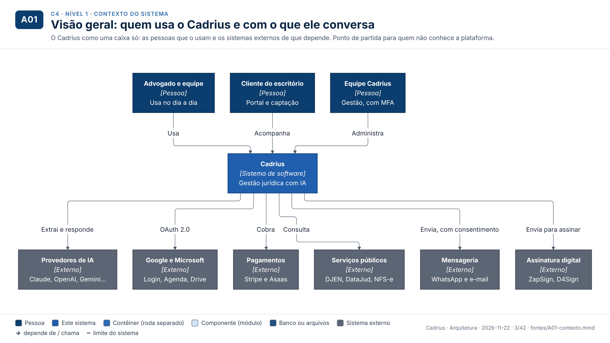

[SVG](svg/A01-contexto.svg) · [fonte](fontes/A01-contexto.mmd)

### A02 · Do que o Cadrius é feito: aplicações e bancos de dados

*C4 · Nível 2 · Contêineres.* As peças que rodam separadamente (aplicação web, API, worker, gateway de WhatsApp) e onde os dados ficam guardados.

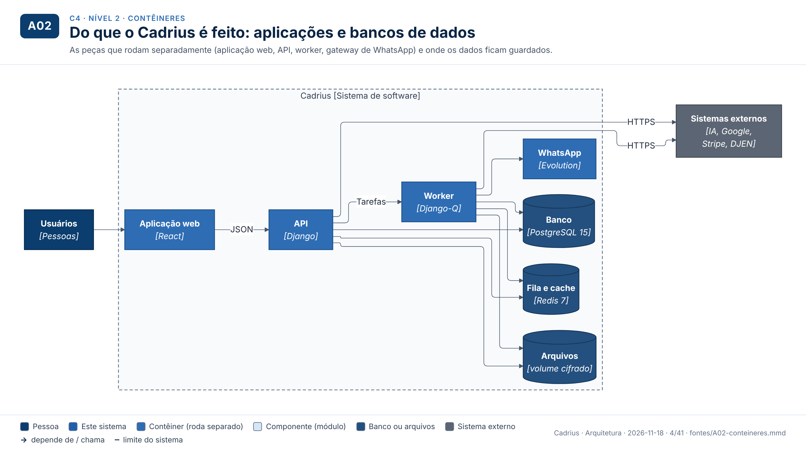

[SVG](svg/A02-conteineres.svg) · [fonte](fontes/A02-conteineres.mmd)

### A03 · Dentro da API: núcleo e rotina do escritório

*C4 · Nível 3 · Componentes.* Os módulos de negócio da API: contas, assinatura, contatos, documentos, processos, tarefas, carteira e importação. Entre colchetes, o nome do módulo no código.

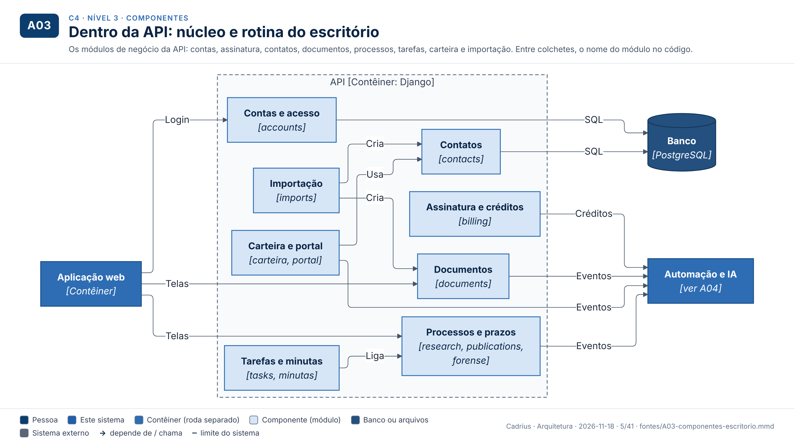

[SVG](svg/A03-componentes-escritorio.svg) · [fonte](fontes/A03-componentes-escritorio.mmd)

### A04 · Dentro da API: automação, IA e integrações

*C4 · Nível 3 · Componentes.* Como os eventos do escritório viram ações: motor de automações, Assistente, IA governada, e-mails, integrações e a camada de segurança e LGPD.

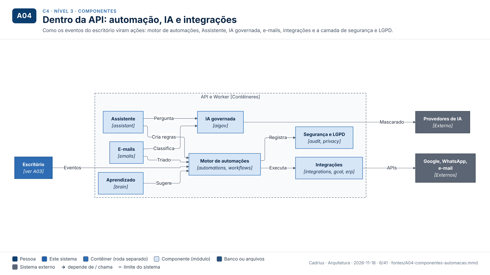

[SVG](svg/A04-componentes-automacao.svg) · [fonte](fontes/A04-componentes-automacao.mmd)

### A05 · Dentro da aplicação web: áreas e acesso à API

*C4 · Nível 3 · Componentes.* As áreas do front-end (público, escritório e Gestão Cadrius) e o serviço único que fala com a API e renova a sessão.

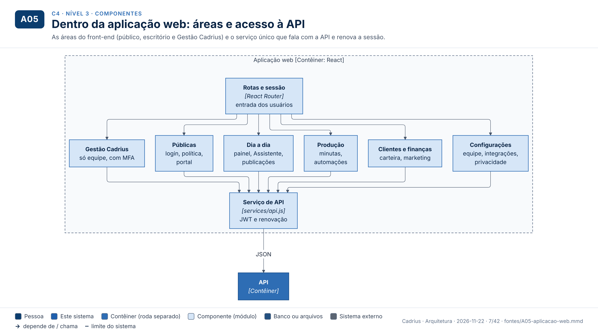

[SVG](svg/A05-aplicacao-web.svg) · [fonte](fontes/A05-aplicacao-web.mmd)

### A06 · Onde roda: servidor, contêineres e backups

*C4 · Implantação.* Como a produção está montada no servidor: proxy com TLS, contêineres por ambiente, banco compartilhado e backup diário com cópia externa. O ambiente de teste tem a mesma forma.

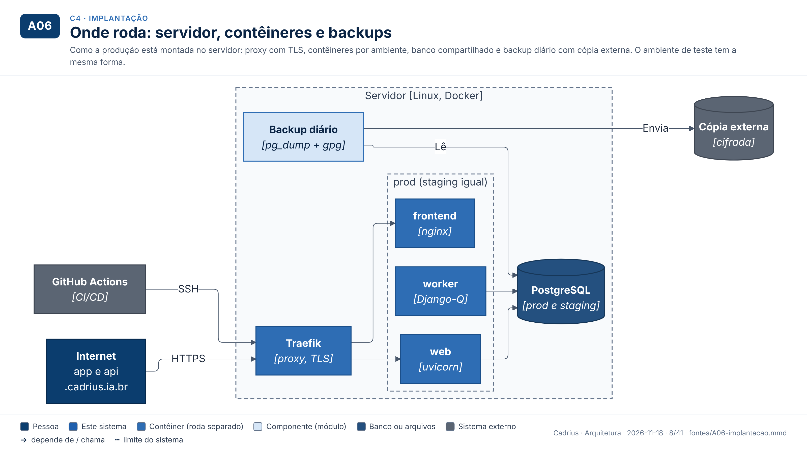

[SVG](svg/A06-implantacao.svg) · [fonte](fontes/A06-implantacao.mmd)

### A07 · Do pull request à produção

*Processo · Entrega contínua.* O caminho de toda mudança: CI com testes e varreduras de segurança, aprovação, backup antes do deploy e rollback automático se a API não responder.

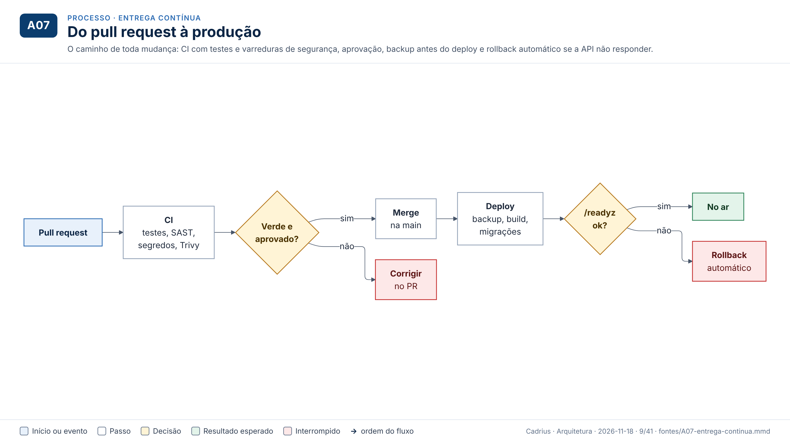

[SVG](svg/A07-entrega-continua.svg) · [fonte](fontes/A07-entrega-continua.mmd)

## Fluxos

### F01 · Login com senha e segundo fator (MFA)

*Fluxo · Sequência.* Entrada com e-mail e senha, código do app autenticador quando o MFA está ligado, e a renovação da sessão sem pedir login de novo.

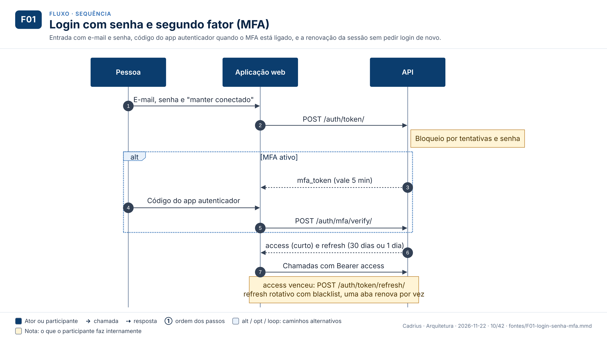

[SVG](svg/F01-login-senha-mfa.svg) · [fonte](fontes/F01-login-senha-mfa.mmd)

### F02 · Login com Google ou Microsoft (SSO)

*Fluxo · Sequência.* A pessoa autoriza no Google ou na Microsoft; a API valida a identidade e entrega a sessão do Cadrius. Nenhuma senha do Google passa pelo Cadrius.

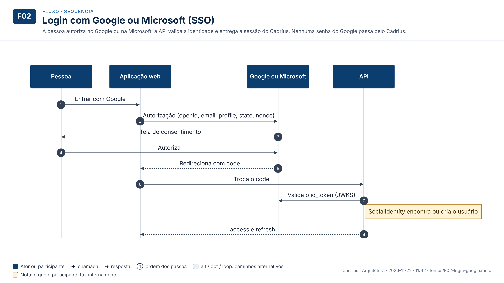

[SVG](svg/F02-login-google.svg) · [fonte](fontes/F02-login-google.mmd)

### F03 · Leitura de documento com IA

*Fluxo · Sequência.* O arquivo é gravado cifrado, lido em segundo plano com dados mascarados e só vira informação do processo depois que o advogado confere.

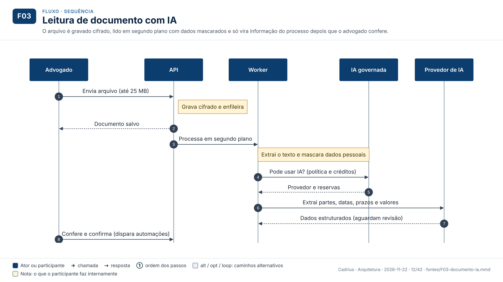

[SVG](svg/F03-documento-ia.svg) · [fonte](fontes/F03-documento-ia.mmd)

### F04 · Automação: do evento ao plano

*Fluxo · Decisão (1 de 2).* Cada evento passa por regra ligada, repetição e condições. Os passos internos rodam na hora; os externos (mensagens, ERP) seguem para F05.

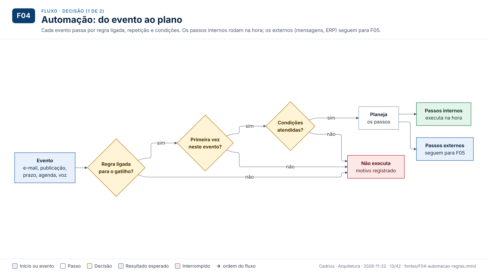

[SVG](svg/F04-automacao-regras.svg) · [fonte](fontes/F04-automacao-regras.mmd)

### F05 · Automação: aprovação e envio

*Fluxo · Decisão (2 de 2).* Antes de qualquer mensagem sair: aprovação (quando a autonomia exige), autorização do contato para o canal e horário comercial.

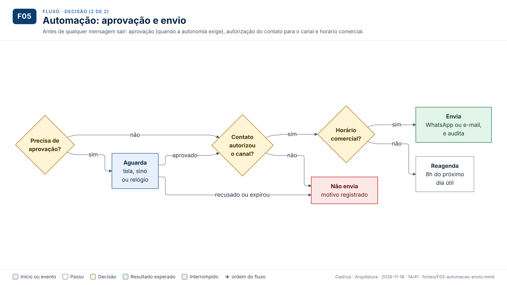

[SVG](svg/F05-automacao-envio.svg) · [fonte](fontes/F05-automacao-envio.mmd)

### F06 · Assistente IA: pedido, prévia e confirmação

*Fluxo · Sequência.* O Assistente consulta os dados por ferramentas e transforma ações em um cartão de confirmação; nada é gravado sem o clique da pessoa.

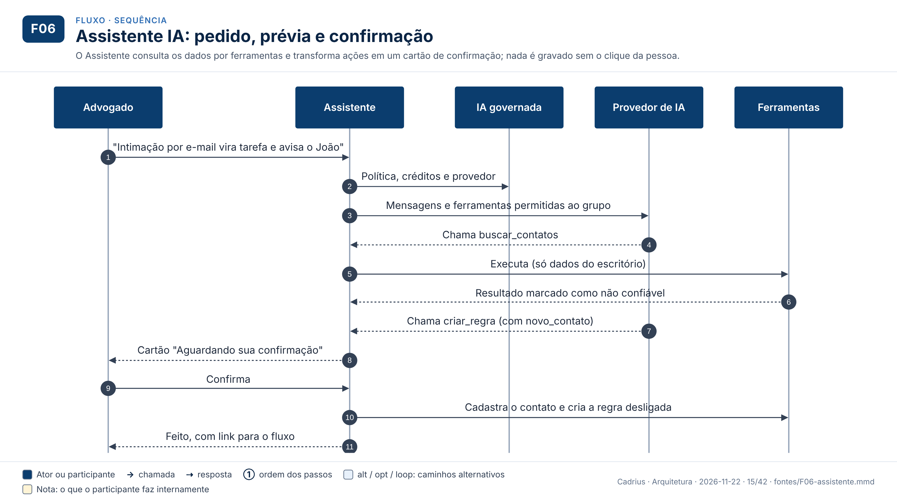

[SVG](svg/F06-assistente.svg) · [fonte](fontes/F06-assistente.mmd)

### F07 · Assinatura e pagamento (Stripe)

*Fluxo · Sequência.* O checkout acontece no Stripe; o plano só é liberado pelo webhook assinado, com valor e idempotência conferidos.

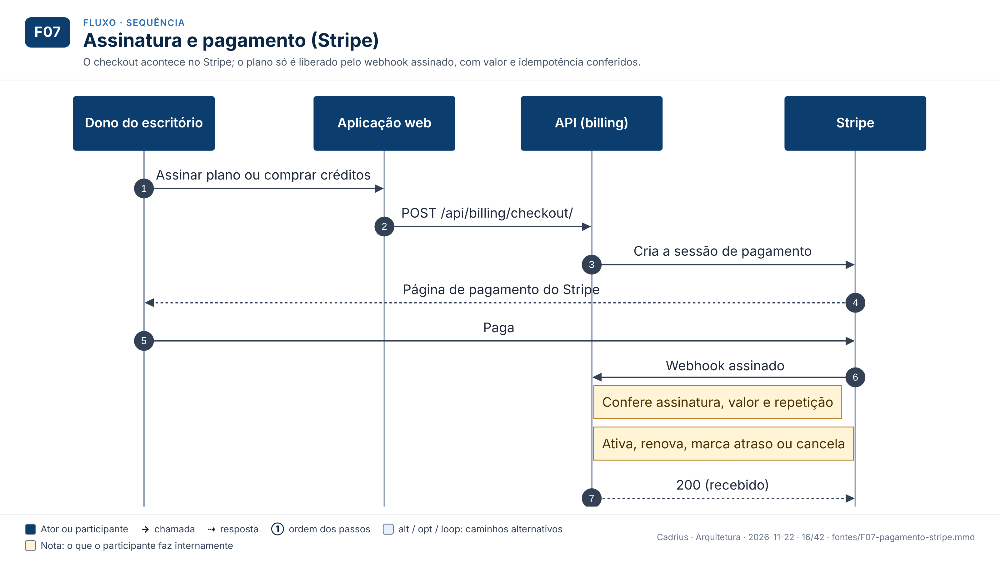

[SVG](svg/F07-pagamento-stripe.svg) · [fonte](fontes/F07-pagamento-stripe.mmd)

### F08 · Publicações do DJEN e prazos

*Fluxo · Processo.* A cada 3 horas o Cadrius busca as publicações, sugere o prazo em dias úteis e só agenda depois que o advogado confirma.

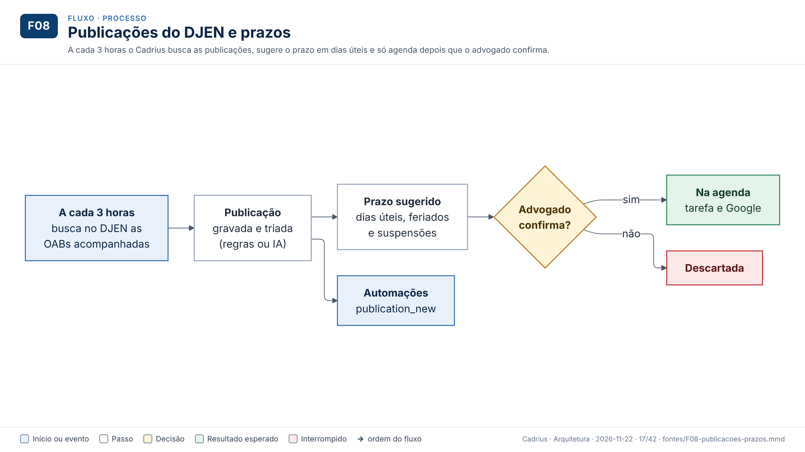

[SVG](svg/F08-publicacoes-prazos.svg) · [fonte](fontes/F08-publicacoes-prazos.mmd)

### F09 · Importação da carteira de clientes (pastas)

*Fluxo · Sequência.* Cada pasta vira um cliente e os arquivos, documentos dele. A prévia não grava nada; a importação roda em etapas e continua de onde parou.

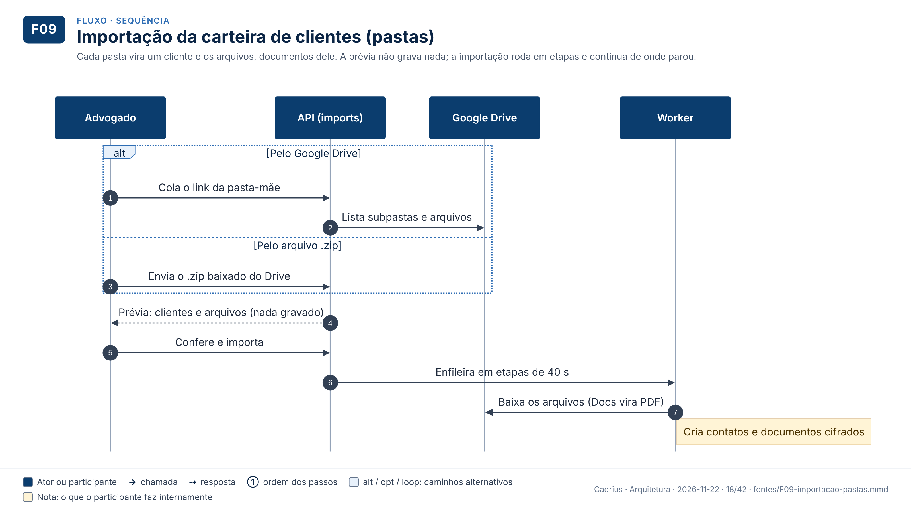

[SVG](svg/F09-importacao-pastas.svg) · [fonte](fontes/F09-importacao-pastas.mmd)

## Segurança e operação

### S01 · As 8 camadas de proteção

*Segurança · Defesa em profundidade.* Cada camada protege mesmo que a anterior falhe: da borda da rede até a continuidade dos dados.

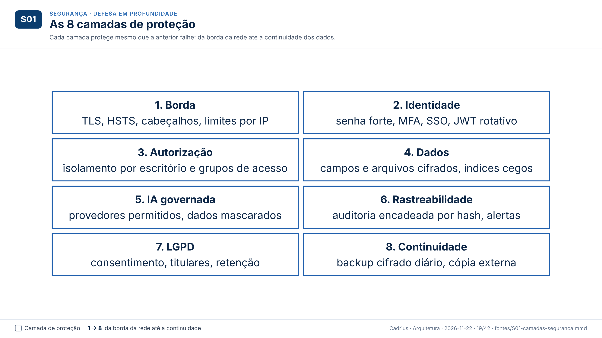

[SVG](svg/S01-camadas-seguranca.svg) · [fonte](fontes/S01-camadas-seguranca.mmd)

### S02 · Ciclo de vida dos dados pessoais

*Segurança · LGPD.* Do momento em que o dado entra até a eliminação, com os prazos de retenção que a política de privacidade promete.

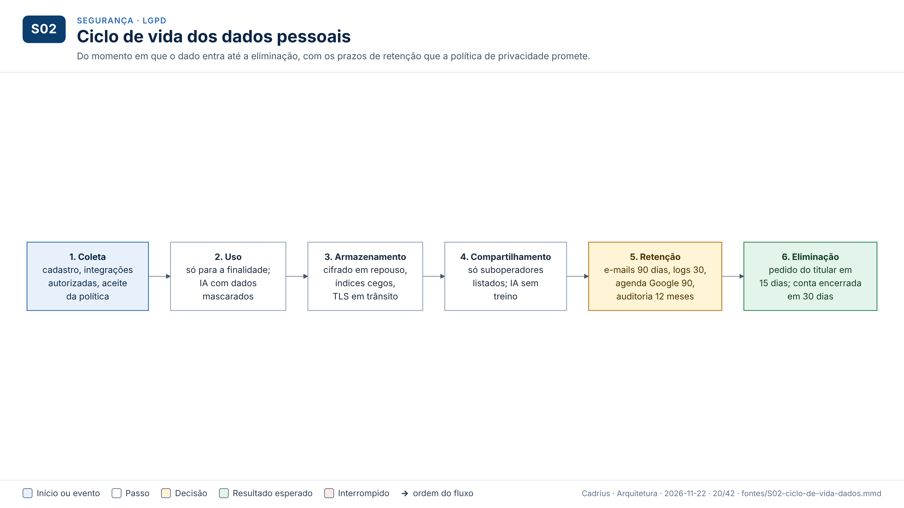

[SVG](svg/S02-ciclo-de-vida-dados.svg) · [fonte](fontes/S02-ciclo-de-vida-dados.mmd)

### S03 · Rotinas automáticas do servidor

*Operação · Rotinas.* O que o worker executa sozinho e com que frequência: anomalias, automações, publicações, fiscal, retenção e auditoria.

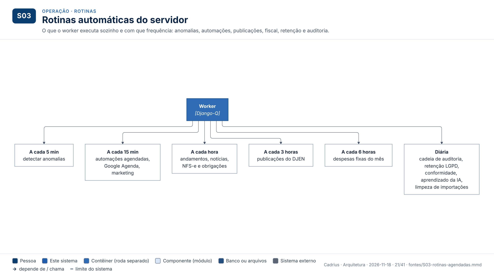

[SVG](svg/S03-rotinas-agendadas.svg) · [fonte](fontes/S03-rotinas-agendadas.mmd)

## Banco de dados

### D00 · Banco de dados: mapa das áreas

*Modelo de dados · Visão geral.* 109 tabelas do Cadrius em 19 áreas de até 8 tabelas. As setas mostram as chaves estrangeiras entre áreas; as que todas têm para D01 (escritório e autoria) ficam de fora. As tabelas da biblioteca de filas estão à parte, em D20.

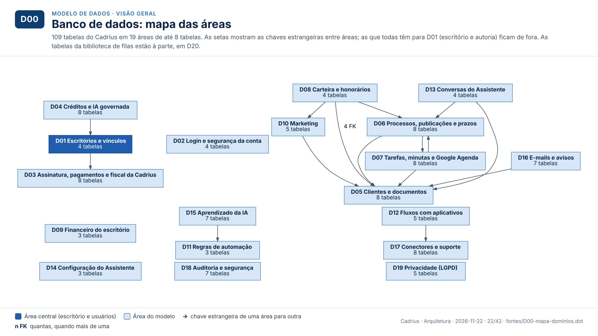

[SVG](svg/D00-mapa-dominios.svg) · [fonte](fontes/D00-mapa-dominios.dot)

### D01 · Banco de dados: Escritórios e vínculos

*Modelo de dados · Entidade-relacionamento.* Escritórios, usuários, vínculos e grupos de acesso. Toda tabela das outras áreas aponta para Organization (o escritório) e, quando registra autoria, para CustomUser. Liga-se a D03.

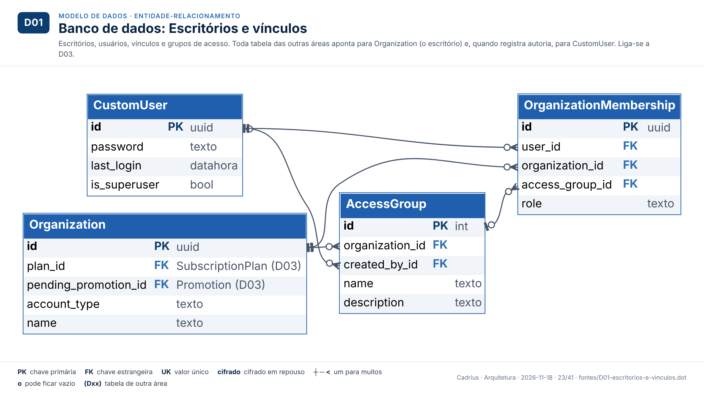

[SVG](svg/D01-escritorios-e-vinculos.svg) · [fonte](fontes/D01-escritorios-e-vinculos.dot)

### D02 · Banco de dados: Login e segurança da conta

*Modelo de dados · Entidade-relacionamento.* Segundo fator (MFA) e códigos de recuperação, identidades de login social (Google, Microsoft) e contadores de envio por usuário.

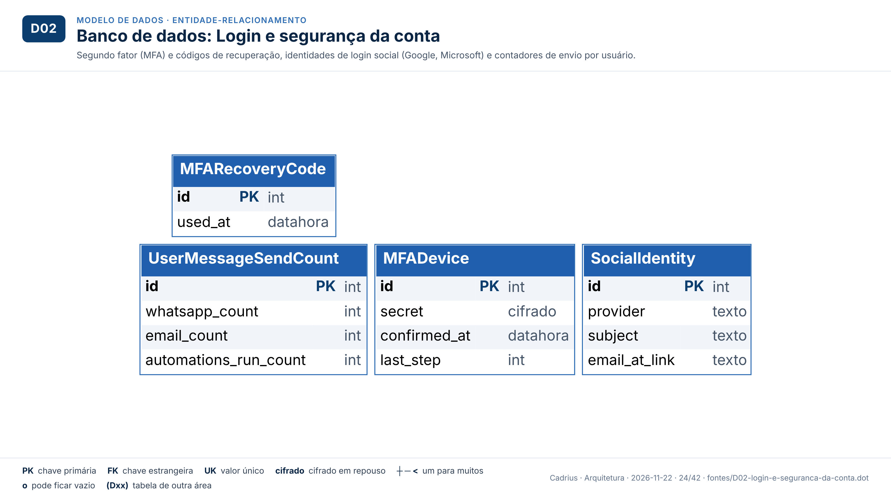

[SVG](svg/D02-login-e-seguranca-da-conta.svg) · [fonte](fontes/D02-login-e-seguranca-da-conta.dot)

### D03 · Banco de dados: Assinatura, pagamentos e fiscal da Cadrius

*Modelo de dados · Entidade-relacionamento.* Planos, histórico de preço, pagamentos do Stripe, cupons, adicional de mídia e obrigações fiscais da própria Cadrius.

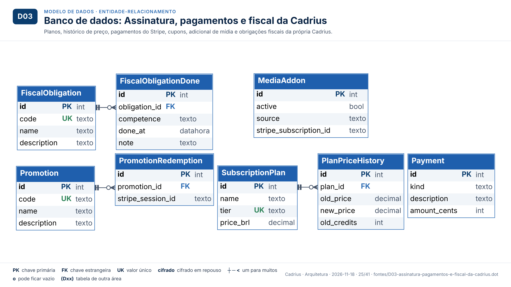

[SVG](svg/D03-assinatura-pagamentos-e-fiscal-da-cadrius.svg) · [fonte](fontes/D03-assinatura-pagamentos-e-fiscal-da-cadrius.dot)

### D04 · Banco de dados: Créditos e IA governada

*Modelo de dados · Entidade-relacionamento.* Pacotes e lotes de créditos, peso de cada operação, consumo por membro e as políticas que decidem qual provedor de IA o escritório pode usar. Liga-se a D01.

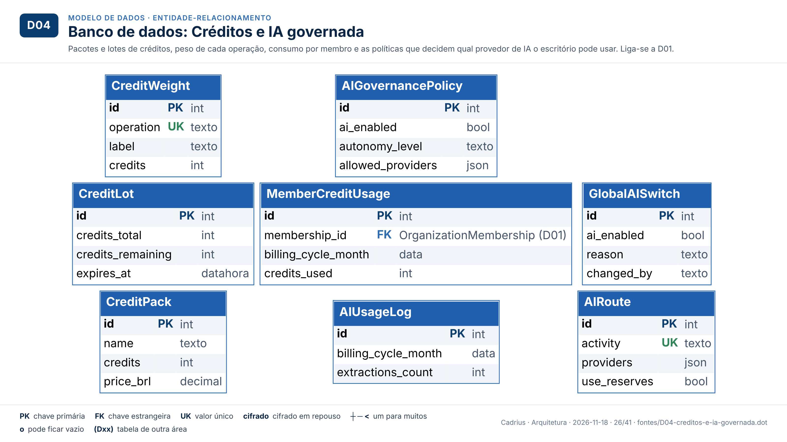

[SVG](svg/D04-creditos-e-ia-governada.svg) · [fonte](fontes/D04-creditos-e-ia-governada.dot)

### D05 · Banco de dados: Clientes e documentos

*Modelo de dados · Entidade-relacionamento.* Contatos do escritório, documentos cifrados, leitura com IA, portal do cliente e importações (planilhas e pastas).

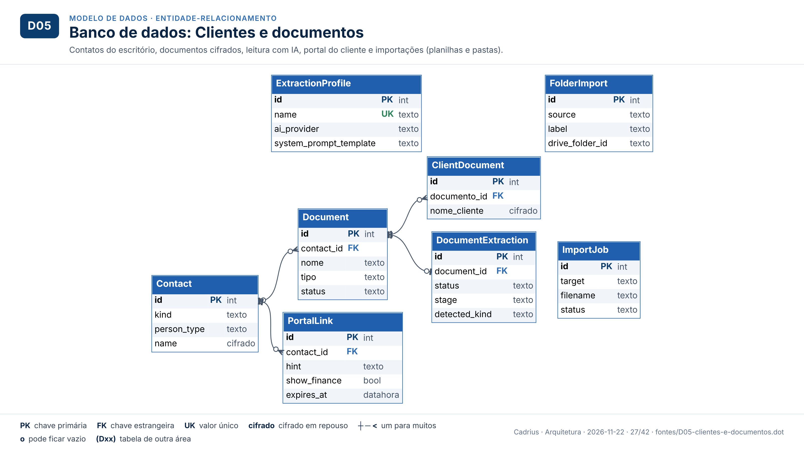

[SVG](svg/D05-clientes-e-documentos.svg) · [fonte](fontes/D05-clientes-e-documentos.dot)

### D06 · Banco de dados: Processos, publicações e prazos

*Modelo de dados · Entidade-relacionamento.* Processos monitorados e andamentos, OABs acompanhadas no DJEN, publicações, feriados e suspensões dos tribunais. Liga-se a D05, D07.

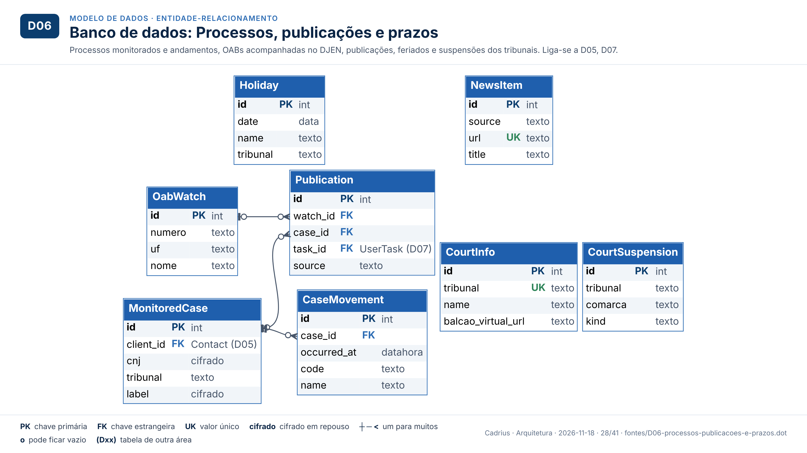

[SVG](svg/D06-processos-publicacoes-e-prazos.svg) · [fonte](fontes/D06-processos-publicacoes-e-prazos.dot)

### D07 · Banco de dados: Tarefas, minutas e Google Agenda

*Modelo de dados · Entidade-relacionamento.* Tarefas e prazos, modelos e minutas, e a ligação com o Google (agenda, eventos trazidos e arquivos criados no Drive). Liga-se a D05, D06.

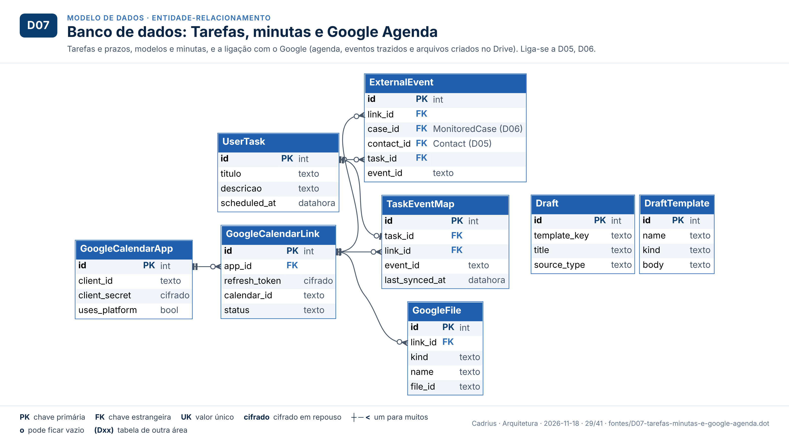

[SVG](svg/D07-tarefas-minutas-e-google-agenda.svg) · [fonte](fontes/D07-tarefas-minutas-e-google-agenda.dot)

### D08 · Banco de dados: Carteira e honorários

*Modelo de dados · Entidade-relacionamento.* Oportunidades, contratos de honorários, contas a receber e despesas ligadas a clientes e processos. Liga-se a D05, D06, D10.

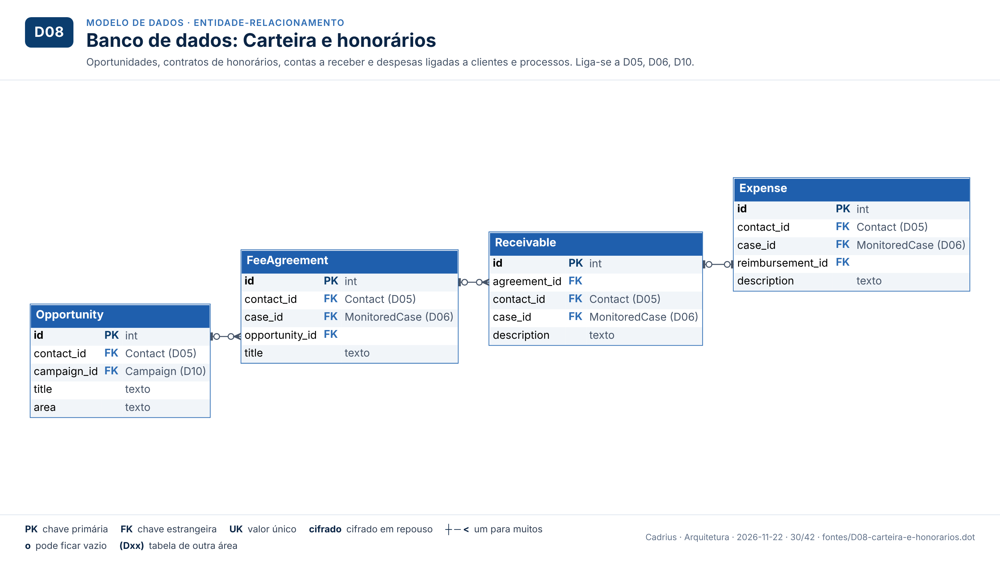

[SVG](svg/D08-carteira-e-honorarios.svg) · [fonte](fontes/D08-carteira-e-honorarios.dot)

### D09 · Banco de dados: Financeiro do escritório

*Modelo de dados · Entidade-relacionamento.* Despesas fixas, metas e regime fiscal do escritório e eventos recebidos do Asaas (cobrança).

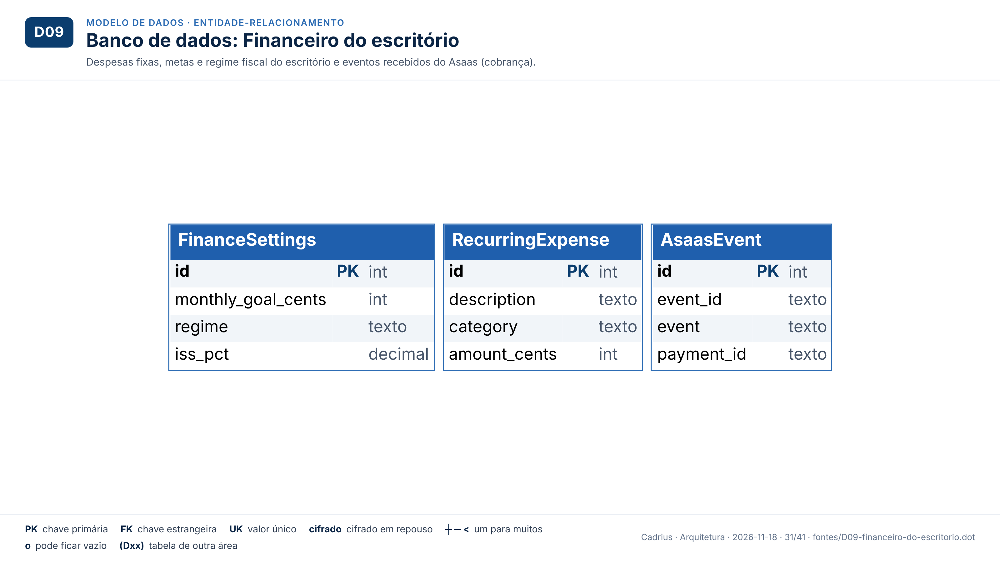

[SVG](svg/D09-financeiro-do-escritorio.svg) · [fonte](fontes/D09-financeiro-do-escritorio.dot)

### D10 · Banco de dados: Marketing

*Modelo de dados · Entidade-relacionamento.* Campanhas, conteúdos, imagens, formulários de captação e pesquisas de satisfação. Liga-se a D05.

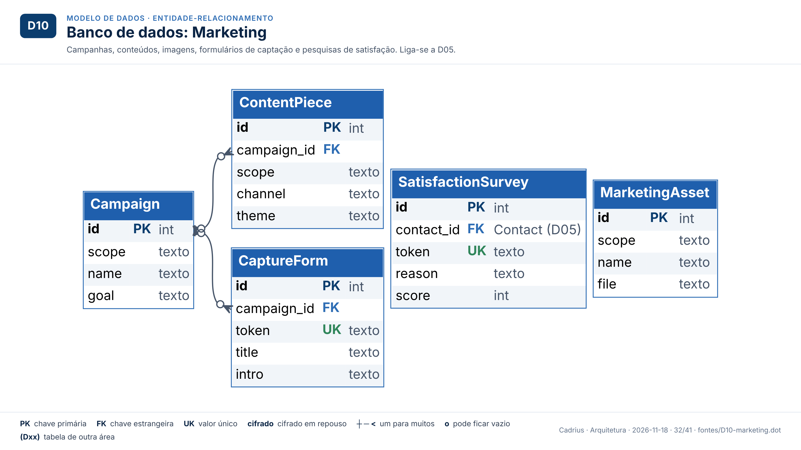

[SVG](svg/D10-marketing.svg) · [fonte](fontes/D10-marketing.dot)

### D11 · Banco de dados: Regras de automação

*Modelo de dados · Entidade-relacionamento.* Regras (gatilho, condições e passos), cada execução com seu resultado e os aparelhos pessoais que aprovam pelo relógio ou celular.

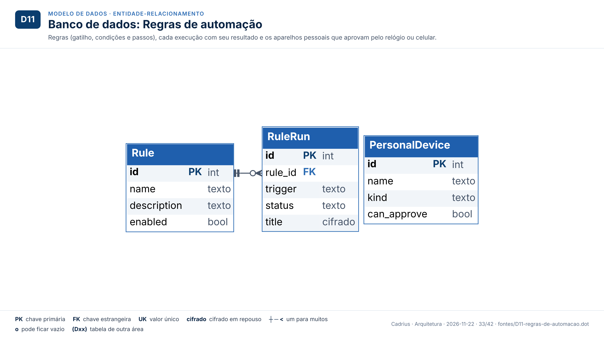

[SVG](svg/D11-regras-de-automacao.svg) · [fonte](fontes/D11-regras-de-automacao.dot)

### D12 · Banco de dados: Fluxos com aplicativos

*Modelo de dados · Entidade-relacionamento.* Fluxos visuais com gatilhos de aplicativos externos e webhooks, ações e registro de execução. Liga-se a D17.

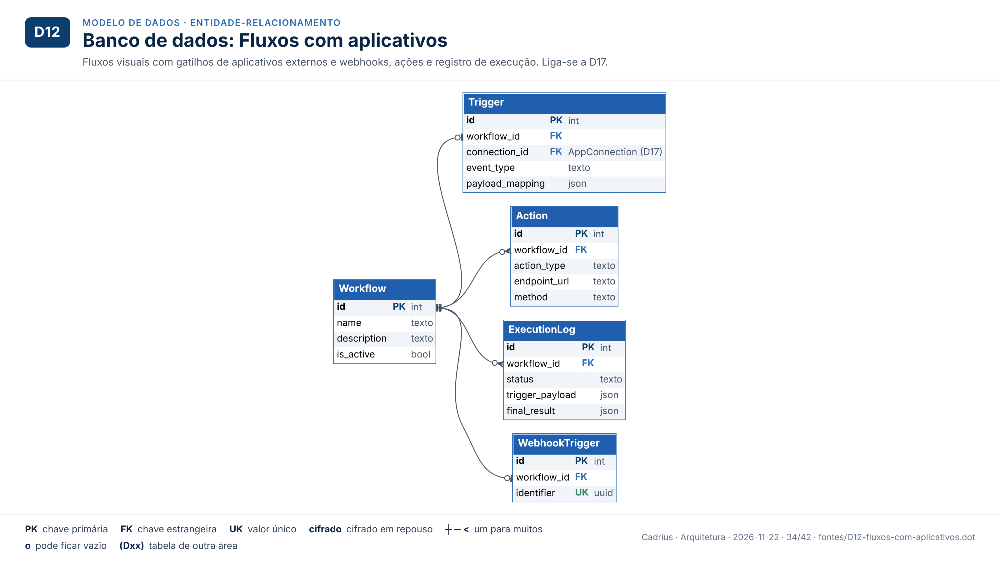

[SVG](svg/D12-fluxos-com-aplicativos.svg) · [fonte](fontes/D12-fluxos-com-aplicativos.dot)

### D13 · Banco de dados: Conversas do Assistente

*Modelo de dados · Entidade-relacionamento.* Conversas, mensagens, ações que aguardam a confirmação da pessoa e o registro de tudo o que a IA fez. Liga-se a D05, D06.

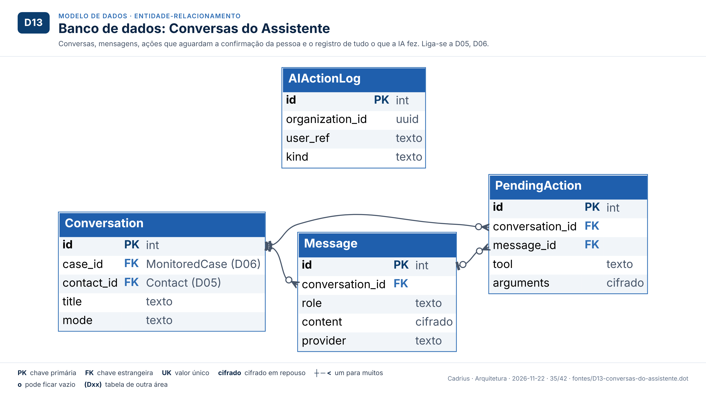

[SVG](svg/D13-conversas-do-assistente.svg) · [fonte](fontes/D13-conversas-do-assistente.dot)

### D14 · Banco de dados: Configuração do Assistente

*Modelo de dados · Entidade-relacionamento.* Preferências do Assistente por escritório, chaves próprias de IA (BYOK) e tokens pessoais para conectar o Cadrius a outras IAs (MCP).

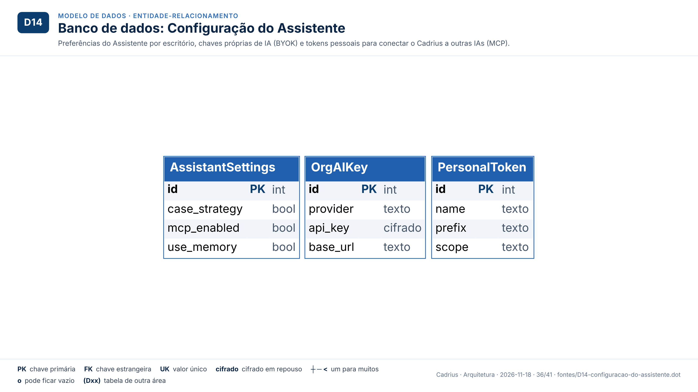

[SVG](svg/D14-configuracao-do-assistente.svg) · [fonte](fontes/D14-configuracao-do-assistente.dot)

### D15 · Banco de dados: Aprendizado da IA

*Modelo de dados · Entidade-relacionamento.* Memória e regras do escritório, feedback, nível de autonomia e sugestões de automação. Liga-se a D11.

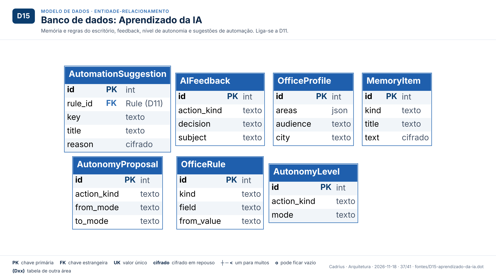

[SVG](svg/D15-aprendizado-da-ia.svg) · [fonte](fontes/D15-aprendizado-da-ia.dot)

### D16 · Banco de dados: E-mails e avisos

*Modelo de dados · Entidade-relacionamento.* Caixas de e-mail, mensagens recebidas e triagem, notificações do sistema e avisos de cobrança. Liga-se a D05.

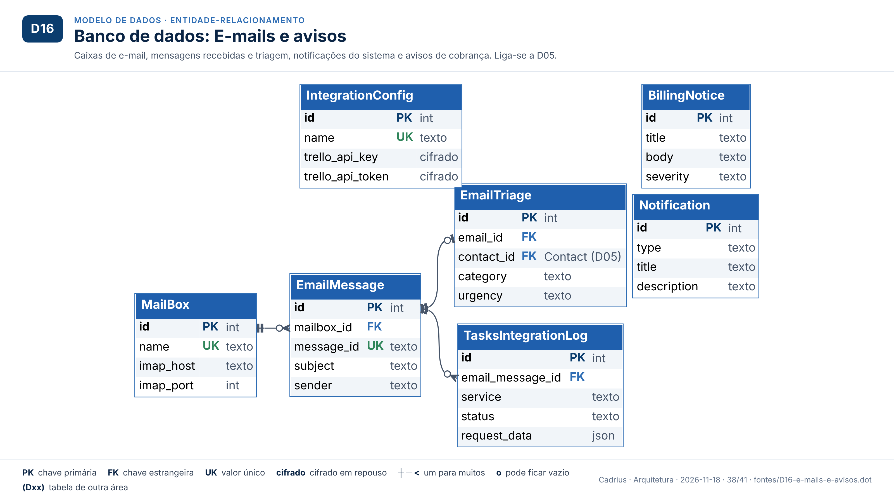

[SVG](svg/D16-e-mails-e-avisos.svg) · [fonte](fontes/D16-e-mails-e-avisos.dot)

### D17 · Banco de dados: Conectores e suporte

*Modelo de dados · Entidade-relacionamento.* Conexões com aplicativos e ERP com seus registros de chamada, e os chamados de suporte com acesso temporário.

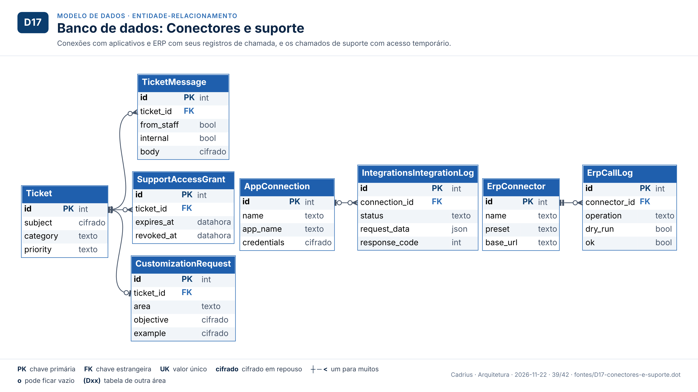

[SVG](svg/D17-conectores-e-suporte.svg) · [fonte](fontes/D17-conectores-e-suporte.dot)

### D18 · Banco de dados: Auditoria e segurança

*Modelo de dados · Entidade-relacionamento.* Trilha de auditoria encadeada por hash, pontos de verificação, alertas de anomalia, IPs bloqueados e avaliação de controles.

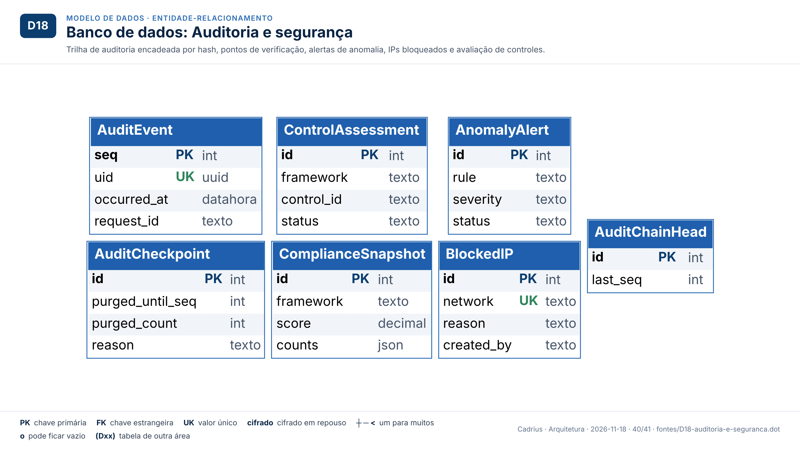

[SVG](svg/D18-auditoria-e-seguranca.svg) · [fonte](fontes/D18-auditoria-e-seguranca.dot)

### D19 · Banco de dados: Privacidade (LGPD)

*Modelo de dados · Entidade-relacionamento.* Documentos legais versionados, aceites, suboperadores, pedidos dos titulares e desligamento de escritórios.

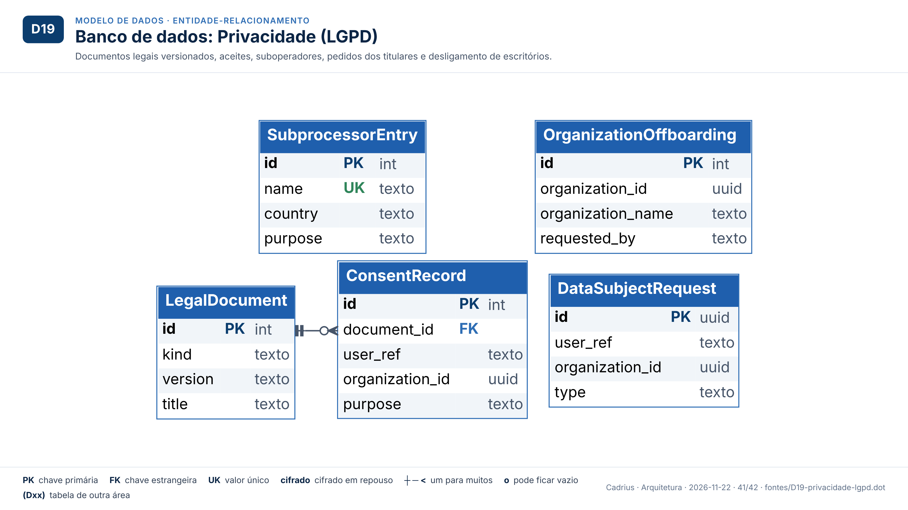

[SVG](svg/D19-privacidade-lgpd.svg) · [fonte](fontes/D19-privacidade-lgpd.dot)

### D20 · Banco de dados: Filas e agendamentos (Django-Q)

*Modelo de dados · Entidade-relacionamento.* Tabelas da biblioteca Django-Q, que roda as rotinas da S03. Schedule guarda o que repete e quando; cada disparo vira uma Task com o resultado (Schedule.task aponta para a última, Task.name repete o nome do agendamento; não há chave estrangeira). OrmQ fica vazia: a fila do Cadrius é o Redis.

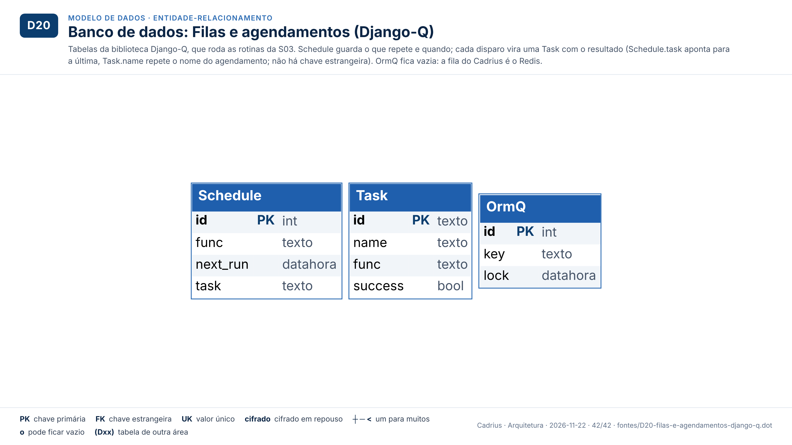

[SVG](svg/D20-filas-e-agendamentos-django-q.svg) · [fonte](fontes/D20-filas-e-agendamentos-django-q.dot)
